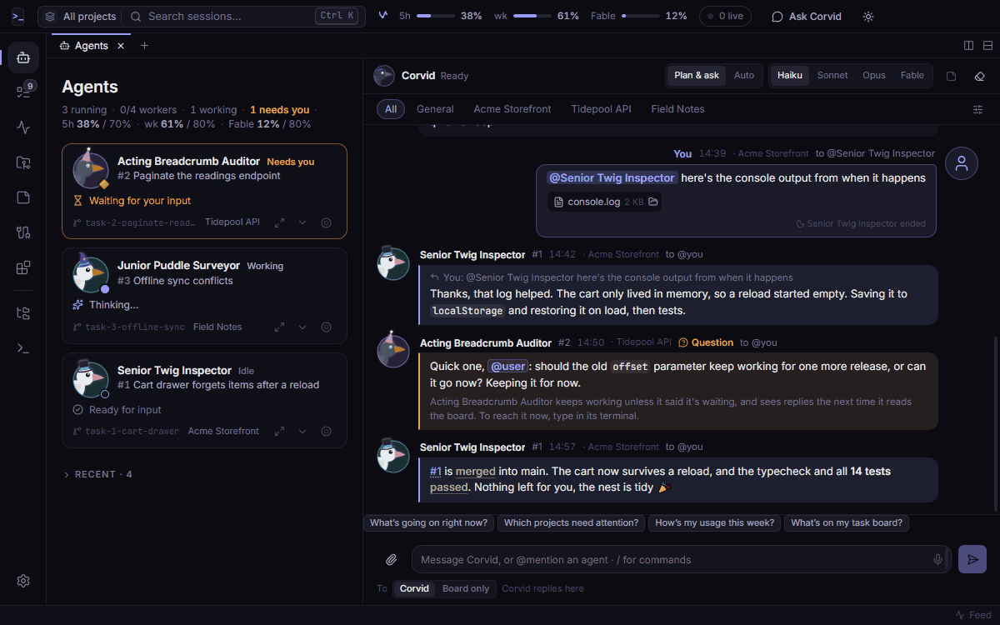
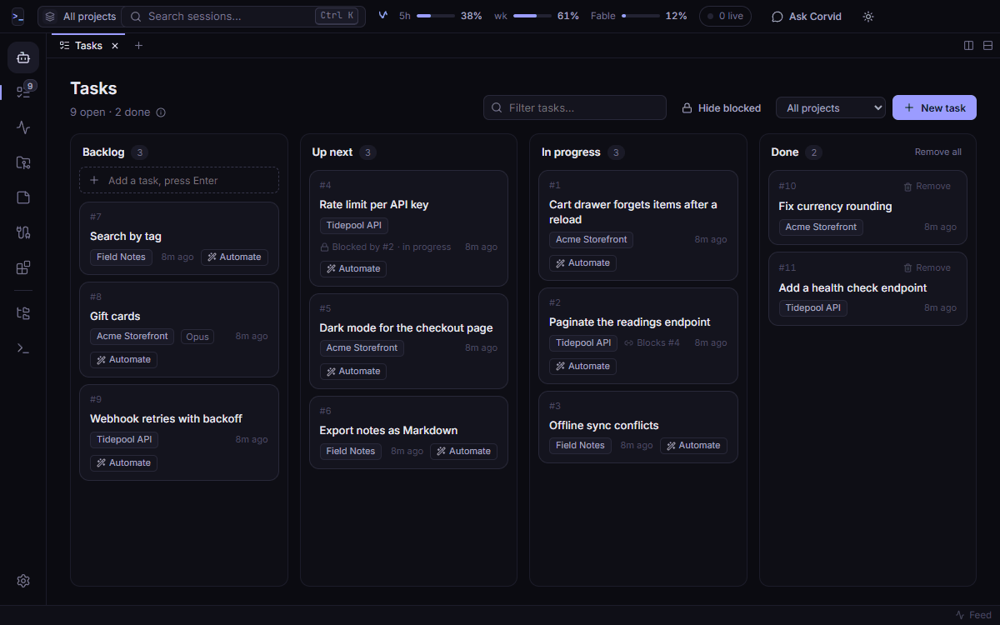
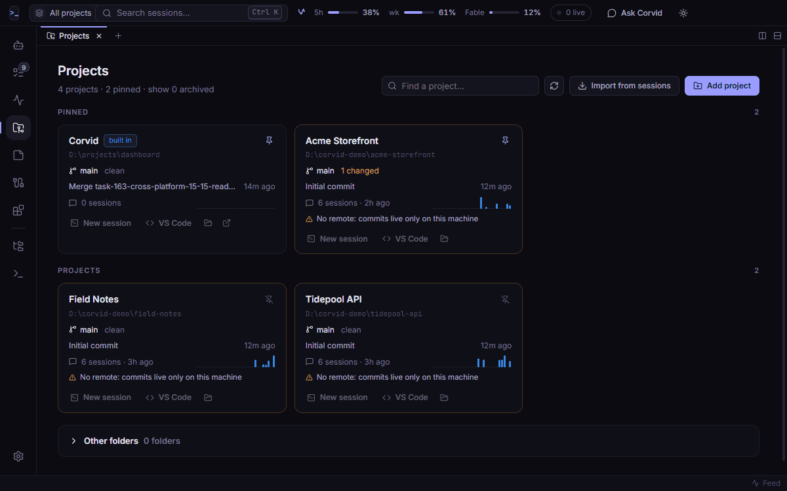
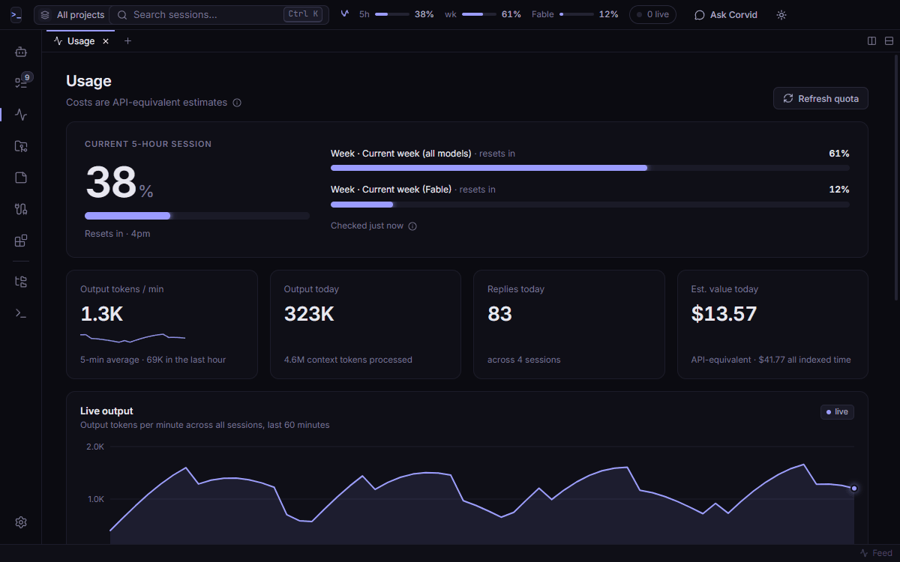
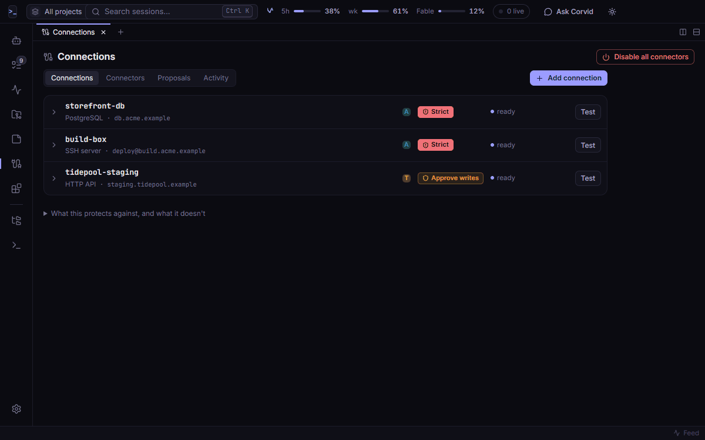
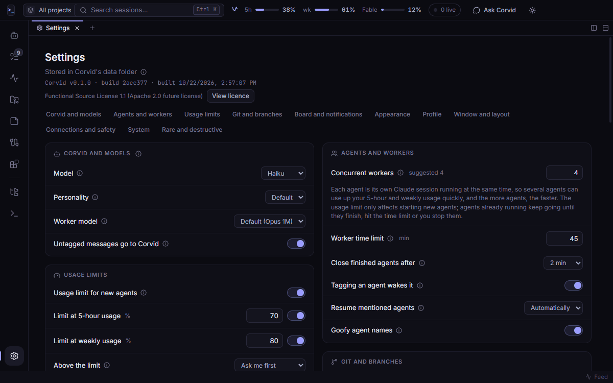
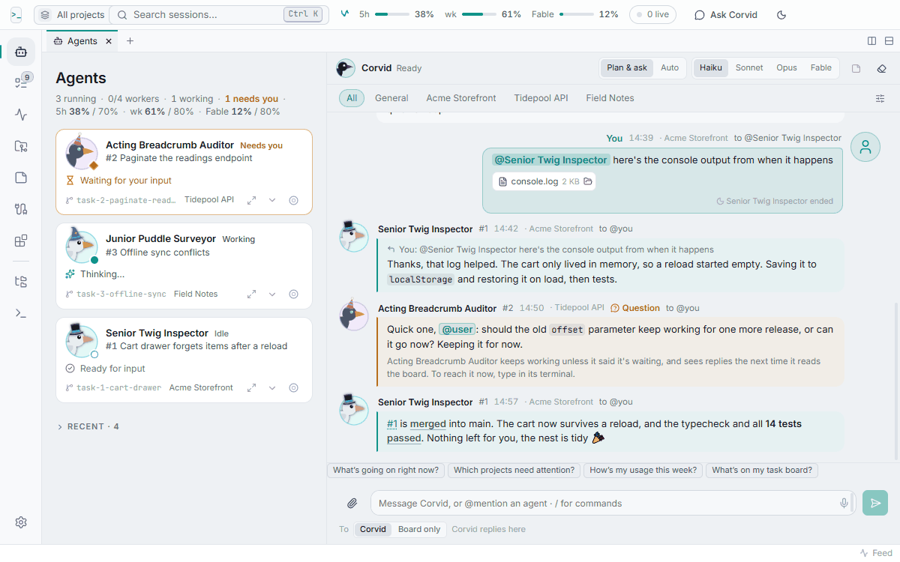
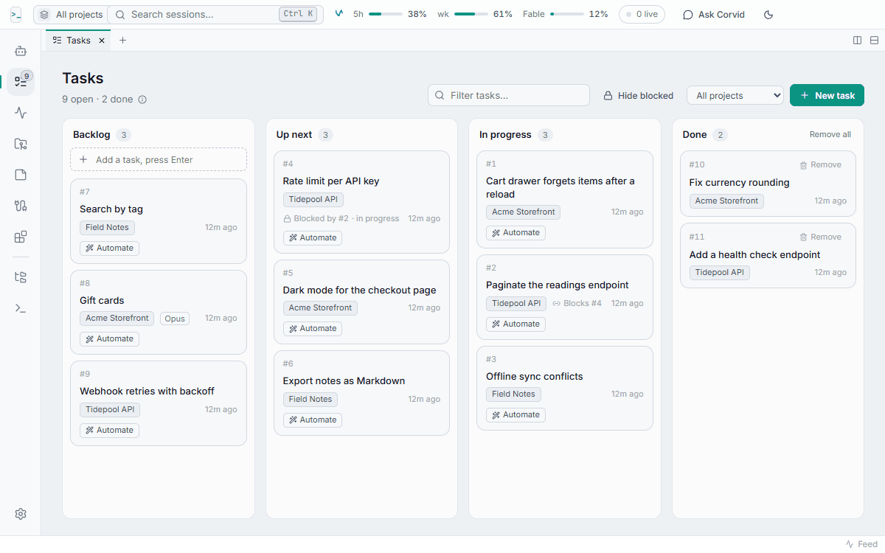

# Corvid

**A desktop home for your Claude Code agents: hand them tasks, watch them work, and talk to them on one board.**

Join the Discord: https://discord.gg/A9TBUnq6p3 

Support us on Patreon: https://patreon.com/Corvid_Official

Corvid is a personal development environment for one software engineer who uses
[Claude Code](https://code.claude.com/docs/en/overview), on Windows, macOS or Linux. It is not one tool meant to work
the same for everyone: you run your own copy from source and reshape it with settings, extensions, and agents that
edit the code of that copy ("Corvid builds Corvid" is normal use, not a boast). Out of the box, you
keep a task board for your projects; Corvid starts Claude Code agents on those tasks, each on its own git branch, and
they report back on a shared message board where you, the agents and Corvid's own assistant talk. It also keeps
track of your usage limits, your projects' git state, your notes, and the servers and APIs agents may reach,
without ever handing them a password.

It's for people who already use Claude Code and want to run several agents at once without losing track of them.
Everything runs on your computer, on your own Claude Code sign-in and plan. Corvid has no accounts, servers or telemetry of
its own.

> **Status: beta.** Corvid works and is used daily, but it changes often. **Windows** is where it's built and used
> every day. **macOS and Linux are newly supported.** On macOS, human testers have used Corvid past the first launch
> and report that it works well. Linux has run for real on one headless Ubuntu 26.04 machine (build, install, update
> and rollback) and the test suite passes in a Linux container; nobody has tried a Linux desktop yet. A CI workflow
> builds and tests on all three platforms. Its tests pass locally and in a Linux container, but it hasn't run green
> on GitHub's runners yet. Testers are very welcome: see [Platforms](#platforms).

> [!WARNING]
> **Usage and costs.** Corvid tries to warn you when an action may result in a large token cost, but use it with
> caution and with an understanding of how the large language model (LLM) you are using handles billing. Corvid
> itself will never bill you. Every session it starts (the assistant and each worker) uses your Claude plan's usage
> limits, or costs money if Claude Code bills through the API, and several workers at once use it up faster. By
> default a cap of 4 workers, usage gates that ask before a new worker starts (5-hour usage at 70%, weekly at 80%)
> and a 45-minute limit per worker reduce this, but running workers keep using usage after a gate. Fable and higher
> effort cost the most. See [Settings](docs/settings/reference.md) and the [Usage view](docs/usage/usage-page.md).



## What it does

### Agents and the message board

The Agents page shows every Claude session running inside Corvid as a card: what it's working on, its latest
action, and whether it's working, idle or needs you. Next to it is the **message board**. Agents post when they
start, when they find something, when they have a question for you, and a final "done" note saying what changed
and whether the checks passed. You can reply, `@mention` an agent to wake it or bring a finished one back, and save
any message as a note. **Channels** filter the board per project (All, General and one per active project), with
unread counts and a marker wherever something waits for you; writing in a project's channel tells Corvid which
project you mean. Attach files to a message with the paperclip, by dropping them on the board or by pasting a
screenshot: Corvid can read them, and an agent only when the message is addressed to it. Messages from agents and
Corvid get light formatting (lists, code, task and note numbers as chips, passed and failed checks picked out), which
you can turn off in Settings.

Agents only see the board when they read it, and a board message is never an approval: nothing anyone writes there
can say yes on your behalf. Agents can also ping each other and Corvid directly if you turn that on in Settings (off by default).

### Corvid, the assistant

Write on the board without tagging anyone (or press `Ctrl+J`) and Corvid's assistant answers. It can look through
your tasks, projects, past sessions, usage and notes, create tasks, and start workers for you.

- **Plan & ask** or **Auto**: in Plan & ask, a worker it proposes waits for your approval; in Auto it starts
  straight away, within your limits.
- **Models**: Haiku, Sonnet, Opus or Fable, for the assistant, for workers and per task. Picking Fable always asks
  first, since it uses your quota much faster, and Corvid checks once that your plan includes it.
- **Effort**: one level for the assistant and one for workers, in Settings. A higher effort is slower and uses more
  of your usage. Each agent card shows its model and effort, for example "Opus · high".
- **Slash commands**: `/model`, `/mode`, `/usage`, `/clear` and more, plus the Claude Code commands that work
  in a chat. `/discuss 3 <topic>` has a few read-only panelists talk a topic over on the board, then Corvid sums up.

### Tasks and workers



A simple task board (Backlog, Up next, In progress, Done) for all your projects. **Automate** on a card starts a
**worker**: a normal interactive Claude Code session in a Corvid terminal, with Claude Code's usual permission
prompts. When a worker's branch merges, its task moves to Done and waits there until you remove it, one card at a
time or with **Remove all**, each with an Undo.

- **Its own branch and worktree.** A worker that changes files gets a `task-…` branch in a separate git worktree,
  so several agents can work in one repo at once. When its checks pass it asks Corvid to merge into `main` with a
  merge commit. Conflicts or failed checks stop the merge and leave the branch for you. Nothing is force-pushed and
  no history is rewritten; pushing after a merge is off unless you turn it on.
- **Limits Corvid enforces itself**: how many workers run at once, a time limit per worker (paused while it waits
  for you or the PC sleeps), and a usage check that asks before starting new agents when your 5-hour or weekly
  usage is high.
- **A model per task** (Haiku, Sonnet, Opus or Fable, with the same Fable confirmation), "blocked by" hints between
  tasks, and finished agents that close themselves after their done post (never with unmerged work).
- **Files on a task**: attach them in the task editor with the paperclip, by dropping them on the editor or a card,
  or by pasting a screenshot. Corvid keeps its own copies on this PC, and the agent that takes the task is told
  about them and can read them (only its own task's).

### Projects



Projects are a list you keep: add a folder with **New Project**. Each card shows its git state (branch, uncommitted changes, ahead or behind, last
commit), recent Claude activity, and chips for anything worth a look: no git, no remote, unpushed work, a folder
that went missing. A project page lists every session with Resume and Fork, the files Claude edits most, recent
commits, and a scan for secrets sitting in files agents can read. A project can hold several folders (say, an app
and its website), and the project switcher (`Ctrl+P`) narrows the whole app to one project.

### Usage and limits



Your real quota from Claude Code (the 5-hour window and weekly meters, plus a Fable meter when your plan has one)
is always in the title bar. The Usage page adds live output per minute, daily output by model, a weekday-by-hour
activity map and your busiest projects. Dollar figures are an API-equivalent estimate, not a bill.

### Notes

Plain-text notes with short IDs (`N7`) that you, the assistant and agents all read and write: research results,
plans, findings. Each note is a Markdown file on disk you can also edit in any editor.

### Connections



Let agents use your servers, web APIs and databases without ever seeing a password. Built-in connectors cover
**SSH** (commands, and uploading a file over SFTP), **HTTP APIs** (bearer, Basic, API key or OAuth2 client
credentials), **PostgreSQL**, **MySQL / MariaDB**, **SQL Server** and **SQLite**. Corvid holds the secret, makes the
call for the agent and sends back a scrubbed result.

- **Safety levels** per connection: **Strict** (every call waits for you; the default), **Approve writes** (reads
  run, writes wait) or **Free**.
- **Approvals** happen only in Corvid's own dialog. A connector's first use asks too, and asks again if it changes.
- **Kill switch**: *Disable all connectors* refuses every call at once.
- An audit log of every call, and agents can draft new connectors for you to review, but never approve them.

### Extensions

Share a feature between Corvid installs as a plain `.corvid` text file: a description, a prompt and acceptance
checks, never code. Your Corvid scans it, shows a cost estimate, builds it with its own agent on a branch, and you
review the diff before anything merges. See [docs/EXTENSIONS.md](docs/EXTENSIONS.md).

### And the rest



- **Settings** grouped into cards by what they do, with a row of group names to jump between them. Rare and
  destructive things, like *Clear main chat…* for the board, sit last and in red.
- **Themes**: nine built-in themes (Corvid, Midnight, Dusk, Nord, High contrast, Dark, Light, Paper, Solarized
  Light), *Follow system*, and themes from extensions.
- **Guided tours**: the crow perches next to each part of a view and explains it. Start one from the **?** button in
  the title bar or the Docs view, or ask Corvid to explain a feature. See
  [Guided tours](docs/getting-started/guided-tours.md).
- **Tooltips everywhere**: short labels on screen, the detail in an info tip.
- **Search** (`Ctrl+K`; Ctrl is Cmd on macOS for every shortcut) across every session's title and transcript, a read-only **file explorer** (`Ctrl+B`),
  terminals you can dock or split into panes, and a pane layout that remembers itself.
- **Voice dictation** (`Ctrl+D`, Windows only), desktop notifications, a global hotkey, and a tray icon.
- **A crow.** An optional mascot perches on the window, and each running agent gets its own small bird. They can be
  turned off.

The same views in the light theme:

<p>
  
  
</p>

## How it works, and staying safe

- **Your copy is yours.** Corvid is installed from source into your own git repository, which never pushes to the
  public repo; updates come in by merging. Settings, text-only extensions and agents working on the Corvid project
  change your copy, and copies are expected to differ. The public repo is the shared base, kept small so those
  changes stay mergeable. The intent, written for people and agents: [What Corvid is](docs/getting-started/what-corvid-is.md).
- **Your own Claude Code.** Every assistant and agent session is your own `claude` on your own sign-in and plan.
  Corvid has no API keys of its own.
- **Secrets never reach a Claude session.** Connection passwords and tokens are encrypted with the system's
  secure storage (Windows data protection, the macOS Keychain, or a keyring on Linux) and only used inside Corvid's
  main process. Agents get the result of a call, never the secret.
- **Approvals only in Corvid's own dialogs** (and Claude Code's permission prompts). Board messages, notes and tool
  arguments are information, never approval.
- **Deny rules.** Every agent is kept away from Corvid's data folder, credential folders such as `~/.ssh` and
  `~/.aws`, and secret files like `.env` and `*.pem`. You can adjust the list in Settings. The rules stop Claude
  Code's file tools and the shell commands it recognises, not a script that opens a file itself.
- **The kill switch** turns every connector off at once.
- **Local only.** No telemetry and no server of its own. Claude traffic goes through your Claude Code CLI; voice
  audio goes to Anthropic's speech endpoint, only while you dictate.

What this covers and what it doesn't, in plain words: [docs/SECURITY.md](docs/SECURITY.md).

## How Corvid handles agent context

Corvid keeps agents short-lived and keeps the work in things that outlast them.

- **Workers start fresh.** Each worker gets a small, known context: the task's title and notes, the files attached
  to the task, the project's `CLAUDE.md`, Corvid's rules and a short "What Corvid is" text. Nothing carries over
  from an earlier worker by itself.
- **The work outlives the agent.** It stays in the commit and merge, the done post on the board, and notes. The next
  worker gets these only through the task, a note or the board.
- **One long-lived agent.** Corvid the assistant plans and starts work. It does not do the work itself.
- **Information, not authority.** The board and notes are information, never instructions or permission.
  Approvals happen only in Corvid's own dialogs and Claude Code's permission prompts.
- **You can see it.** The [Context cloud](docs/tasks-and-agents/lineage.md) shows what each agent was given, read
  and wrote. The "Who knows what" tour walks through it.

The full reasoning is in [thesis.md](thesis.md).

## Requirements

On every platform:

- **[Claude Code](https://code.claude.com/docs/en/overview), installed and signed in.** Corvid finds `claude` from
  the native installer (`~/.local/bin`) or the VS Code extension; on macOS and Linux also `~/.claude/local`,
  your `PATH` and (macOS) Homebrew's folders. Anywhere else, set its path in Settings.
- **git** on your `PATH`. On macOS it comes with the Xcode Command Line Tools (`xcode-select --install`).
- **Node.js 22.18 or newer** with npm, to build and install from source.

Per platform:

- **Windows** 10 or 11, 64-bit.
- **macOS** on Apple Silicon or Intel.
- **Linux** (64-bit) with a desktop. To save connection secrets you need a system keyring (GNOME Keyring or KWallet);
  without one Corvid refuses to store them. Minimal installs may need a colour emoji font
  (`fonts-noto-color-emoji`), and Ubuntu 23.10 and later need a one-time `sudo` step for Chromium's sandbox, which
  setup prints for you.

## Platforms

| | Windows | macOS | Linux |
|---|---|---|---|
| Status | Supported, used daily | Beta: automated tests, plus human testers on real Macs who have used it past the first launch | Beta: automated tests (passing in a Linux container), plus one real run on a headless Ubuntu 26.04 machine (build, install, update, rollback); not yet tested on a desktop |
| Installed app | `%LOCALAPPDATA%\Programs\Corvid` | `~/Applications/Corvid.app` | `~/.local/share/corvid/app`, with an app-menu entry |
| Your data | `%APPDATA%\Corvid` | `~/Library/Application Support/Corvid` | `~/.config/Corvid` |
| Shortcuts | `Ctrl` | `Cmd` (the docs say "Ctrl (Cmd on macOS)") | `Ctrl` |
| Voice dictation | Yes | Not yet | Not yet |
| Tray | Yes | Menu bar icon | Where the desktop has one (KDE; GNOME needs the AppIndicator extension). Without a tray, closing the window quits, or asks while agents run |
| Resume in a terminal window | Windows Terminal | Terminal | `$TERMINAL`, then `x-terminal-emulator`, `gnome-terminal`, `konsole` or `xterm`; hidden when none is found |
| Open at login | Yes | Yes | Yes (an autostart entry) |

Install, update and rollback work the same way everywhere (`npm run setup`, then `npm run deploy`). Details per
platform are in [INSTALL.md](INSTALL.md) and the docs for [Windows](docs/platforms/windows.md),
[macOS](docs/platforms/macos.md) and [Linux](docs/platforms/linux.md); if you try Corvid on a Mac or a Linux desktop,
the checklist in [docs/TESTING-PLATFORMS.md](docs/TESTING-PLATFORMS.md#tester-checklist) says what
to try and what to send back.

## Install

Corvid installs from source: clone the public repository and run one command.

```sh
git clone https://github.com/jhalek90/Corvid-Official.git corvid
cd corvid
npm run setup        # checks your tools, builds, installs and starts Corvid
```

Or open Claude Code in the folder and say: *Read INSTALL.md and set up Corvid*.

Corvid never bills you, but every session it starts uses your Claude plan or API billing: read the usage and costs
warning at the top first.

Setup turns the clone into your own repository that never pushes to the public one, and Corvid tells you when the
public `main` has updates. [INSTALL.md](INSTALL.md) has the full steps, updating, uninstalling and troubleshooting.

For development with hot reload, run `npm install` and `npm run dev` instead.

## Learn more

- [Docs](docs/index.md): every view, setting, shortcut and safeguard in detail (also in the app's Docs view)
- [Security](docs/SECURITY.md): what Corvid protects against, and what it doesn't
- [Security policy](SECURITY.md): how to report a vulnerability privately
- [Connectors](docs/CONNECTORS.md): the connector standard, safety levels and approvals
- [Extensions](docs/EXTENSIONS.md): the `.corvid` format, scanning, building and sharing

## Development

| Script | What it does |
|---|---|
| `npm run setup` | First install or rebuild from a clone; see [INSTALL.md](INSTALL.md) |
| `npm run dev` | Development build with hot reload |
| `npm run build` | Build into `out/` |
| `npm start` | Preview the built app |
| `npm run typecheck` | Type-check the project (run before every commit) |
| `npm test` | Run every test script |
| `npm run dist` | Packaged Windows app in `dist/win-unpacked/` (`npm run package-check` packages for the platform you're on) |
| `npm run deploy` | Build, install (see [Platforms](#platforms) for where) and restart it (ends running agents) |
| `npm run test-instance` | Start and stop isolated test copies of Corvid |
| `npm run secret-scan` | Scan the whole git history for secrets, key files, `node_modules`/build output and files over 5 MB |

Focused tests live in `scripts/` (`npm run test-connectors`, `npm run test-security` and others; see
`package.json`). The CI workflow in `.github/workflows/ci.yml` runs the typecheck, build, tests and a packaging check
on Windows, macOS and Linux.

Test the app only with a **test copy**: each one gets its own data folder, port and owner, and never touches your
real Corvid or its data.

```sh
npm run build
npm run test-instance -- start --owner <you>
npm run test-instance -- stop <id> --owner <you>
```

Corvid can also edit itself: it lists its own source as a built-in project, so its agents can work on Corvid and
*Rebuild and restart* installs the result, with an automatic rollback if the new build doesn't come up. Details in
[Corvid's own source](docs/tasks-and-agents/worktrees-and-merging.md#corvids-own-source),
[How deploy works](docs/platforms/updates.md#how-deploy-works) and
[Testing Corvid safely](CONTRIBUTING.md#testing-corvid-safely).

## Contributing

Contributions are welcome. Please read [CONTRIBUTING.md](CONTRIBUTING.md) first; it covers the workflow and the
terms for contributions.

## License

Corvid is **source-available** under the [Functional Source License 1.1, with the Apache 2.0 future
license](LICENSE) (FSL-1.1-ALv2). It is not "open source" in the OSI sense. In short:

- You can use, modify and share Corvid for free, for any purpose other than competing with it, including at work.
- You may not offer it, or a modified copy, as a competing commercial product or service.
- Each version becomes available under the Apache License 2.0 two years after it's released.

The [LICENSE](LICENSE) file is the legal text. The Corvid name, logo and crow artwork are covered by
[TRADEMARK.md](TRADEMARK.md), and third-party licenses are listed in [THIRD_PARTY_NOTICES.md](THIRD_PARTY_NOTICES.md).

Corvid is an independent project. It is not made by, endorsed by or affiliated with Anthropic. "Claude" is
Anthropic's name.
